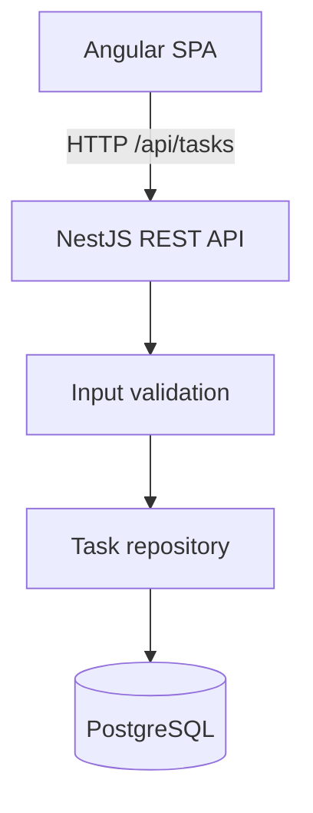

# FlowOps Lite

**A lightweight operations dashboard built with Angular, NestJS, PostgreSQL and TypeScript.**

> **Project status:** early portfolio demo (`v0.1`). This is a self-authored learning and portfolio project, **not** a commercial customer deployment. Screens and data are synthetic. Backend authentication, task ownership, and a protected Angular dashboard exist. Multi-tenancy and production hardening are not complete.

## What it does

- List tasks loaded from a real PostgreSQL database through the NestJS REST API.
- Filter, search, sort and paginate tasks through `GET /api/tasks` (status, priority, `search` on title/team). Optional sort by `dueDate`.
- Create new tasks with both client-side and server-side validation. Description and due date are optional on the API.
- Update task statuses (`To do`, `In progress`, `Done`) and persist changes. Completion timestamps are owned by the server.
- Edit title, team, priority, description, and due date through `PATCH /api/tasks/:id` in the dashboard.
- Dashboard **statistics** use `GET /api/tasks/summary` (authorized scope, not the current search). **Matching tasks** still use `pagination.total` for the current filters.
- Every task has an owner. MEMBER users only see their own tasks; ADMIN can see all.

### Stack

| Layer | Technology |
|---|---|
| Frontend | Angular 20, standalone components, signals, reactive API state, CSS |
| Backend | NestJS 11, TypeScript, parameterized SQL with `pg` |
| Database | PostgreSQL 16 via Docker Compose |
| Quality | Node.js test runner via `tsx` (unit + PostgreSQL integration), GitHub Actions |

## Architecture



The frontend development server proxies `/api` requests to the backend. Frontend and backend share the same domain concepts (task, priority, status), but their code is intentionally kept separate for clarity.

## Run locally (Windows / macOS / Linux)

Requirements: Node.js 22 (`engines.node` `>=22.0.0`; GitHub Actions uses 22). npm, Docker Desktop (or Docker Engine). A working internet connection is required for the initial `npm install`. The OpenAI SDK used by the API declares `node>=22`.

Run from the **repository root**:

```bash
npm install
docker compose up -d
```

Create a local `.env` from `.env.example`, then open **two terminals**:

**Terminal A — API**
```bash
npm run dev:api
```

**Terminal B — Angular SPA**
```bash
npm run dev:web
```

Open **http://127.0.0.1:4300**. The frontend will use the API at `/api/tasks` through its dev proxy. Check **http://localhost:3000/api/health** to verify the API. Docker's default local DB credentials are explicitly **development-only**.

> On Windows PowerShell, to create `.env`: `Copy-Item .env.example .env`. A `.env` file is optional for the default local DB settings, but useful for later configuration. `docker compose up -d` needs Docker Desktop running.

### Run checks

```bash
npm run test
npm run test:integration
npm run build
```

`npm run test` runs API domain/auth/AI unit tests and Angular service/query tests (Node.js `node:test` via `tsx`). `npm run test:integration` runs Nest tests against isolated databases (`flowops_test`, `flowops_test_migrate`, `flowops_test_auth`, `flowops_test_auth_rl`). Those suites never drop, truncate, or migrate-reset `flowops`. Postgres must be running (`docker compose up -d`). GitHub Actions runs both suites. The production build compiles API and web. There are no browser E2E tests in CI. M2.2-B protects the dashboard route and sends CSRF headers on task writes. A local ADMIN browser pass at `http://127.0.0.1:4300` covered the development instance. **M3.1-C** MEMBER/ADMIN/responsive QA used an isolated instance (`flowops_test_m31c`, SPA `http://127.0.0.1:4310` proxying `/api` to port 3010). The development `flowops` database was not reset. Cross-tab refresh can still sign both tabs out. Forced access-token expiry was not re-walked in M3.1-C.

### Database migrations

The API applies versioned SQL from `apps/api/migrations/` on startup, before task seed or queries. A `schema_migrations` table records version, name, checksum and `applied_at`. Pending files run in filename order inside a transaction, under a PostgreSQL advisory lock.

| File | Purpose |
|---|---|
| `001_baseline_tasks.sql` | Creates `tasks` on a fresh database. On an existing FlowOps database it **verifies** the current `tasks` columns/constraints and records the baseline without rewriting the table or touching rows. An incompatible `tasks` table fails the startup instead of being marked applied. |
| `002_create_users.sql` | Adds `users` (unique `LOWER(email)`, role `ADMIN`/`MEMBER`). No user rows are inserted. |
| `003_create_refresh_sessions.sql` | Adds `refresh_sessions` (FK to `users`, unique `token_hash`). No session rows are inserted. |
| `004_task_owner.sql` | Adds `tasks.owner_id` (FK to `users`, index `(owner_id, created_at DESC, id DESC)`). TypeScript backfill assigns unowned legacy rows to an existing ADMIN, then `owner_id` is `NOT NULL`. |
| `005_extend_task_details.sql` | Adds nullable `description` (TEXT), `due_at` (DATE, calendar due date), `completed_at` (TIMESTAMPTZ). Does not backfill completion times. Existing `done` rows keep `completed_at = NULL` when the historical time is unknown. CHECK: `completed_at` is allowed only when `status = 'done'`. Partial index on open tasks with a due date. |

Fresh install: `docker compose up -d` then `npm run dev:api` — migrations create the schema including `owner_id NOT NULL`. Empty databases with **zero users and zero tasks** migrate successfully. Automatic demo task seeding is **disabled**; there is no ownerless seed and no hardcoded demo password. Create tasks after logging in as the bootstrap admin (or any user).

Existing local `flowops` volume: pending migrations apply on API startup. Task rows are not deleted. Unowned legacy tasks are assigned to:

1. `TASK_LEGACY_OWNER_EMAIL` when set (must already be an ADMIN — members are not promoted).
2. Otherwise the single existing ADMIN.
3. If unowned tasks exist and no suitable ADMIN exists, or several ADMINs exist without `TASK_LEGACY_OWNER_EMAIL`, migration **stops** with an actionable error and rolls back. It never creates an admin with a default password.

Migrations currently run **before** admin bootstrap. Bootstrap still only runs when `users` is empty, so it cannot create an owner for pre-existing tasks. Provision an ADMIN before retrying 004 if legacy task rows already exist.

There is no `migrate` CLI; starting the API is enough. Re-running startup is idempotent when SQL files are unchanged. Changing an already-applied file is rejected via checksum.

### API endpoints

| HTTP | Endpoint | Auth | Description |
|---|---|---|---|
| GET | `/api/health` | Public | Service health |
| GET | `/api/tasks` | Access cookie or Bearer | List tasks visible to the caller (MEMBER: own; ADMIN: all) |
| GET | `/api/tasks/summary` | Access cookie or Bearer | Authorized-scope counts (not the current list page) |
| POST | `/api/tasks` | Access + CSRF | Add task owned by the authenticated user |
| PATCH | `/api/tasks/:id` | Access + CSRF | Partial edit of title/team/priority/description/dueDate |
| PATCH | `/api/tasks/:id/status` | Access + CSRF | Update status on a visible task |
| POST | `/api/auth/login` | Public + CSRF | Email/password login; sets cookies |
| POST | `/api/auth/refresh` | Refresh cookie + CSRF | Rotate refresh session; sets new cookies |
| POST | `/api/auth/logout` | Cookie optional + CSRF | Revoke session family; clear cookies |
| GET | `/api/auth/me` | Access cookie or Bearer | Current user |

### Authentication

Angular has a login page at **`/login`**. Serve the SPA at **http://127.0.0.1:4300** (not `localhost`) so cookies and `Origin` match `AUTH_WEB_ORIGIN`. The dashboard at **`/`** requires `authGuard`: anonymous users go to `/login` (optional safe relative `returnUrl`). Already-authenticated visits to `/login` bounce to `/`. The guard waits for `restoreSession()` rather than treating “not initialized” as logged out. Do not treat SameSite=Lax as sufficient CSRF protection.

**Roles (UI copy only — the API still enforces access):** ADMIN sees “All tasks” and authorized-scope statistics for every visible row. MEMBER sees “My tasks”; summary KPIs are that user’s tasks only, never other users. Matching-task captions stay tied to the current filters. Create/edit/status controls stay available because the backend already scopes writes to the session user. There is no assignment UI and `ownerId` is display/server-only.

**HTTP errors:** 401 on APIs other than login/refresh/logout may refresh the access cookie once (single-flight). Failed refresh clears client session and returns to `/login`. 403 (CSRF) and 404 (missing or hidden task) do **not** trigger refresh.

**SPA session**

- `GET /api/auth/me` on startup (`provideAppInitializer`). HttpOnly cookies are sent via `withCredentials`.
- Expired access cookie: interceptor `POST /api/auth/refresh` once (CSRF header), then retries the original request.
- Concurrent 401s in the **same tab** share one in-flight refresh.
- **Multi-tab:** browsers that implement the Web Locks API (Chrome 69+, Firefox 96+, Safari 15.4+) serialize refresh under lock name `flowops-auth-refresh` so tabs wait and then present the **current** HttpOnly cookie. Tokens are not written to web storage or posted between tabs. Server reuse detection is unchanged: a replaced token still revokes the family. Without Web Locks, two tabs can still race and sign the user out.
- Logout: `POST /api/auth/logout` with `X-Requested-With: FlowOpsWeb`. Local user state is cleared only after a successful response, then navigate to `/login`. Access JWTs may still verify for up to 15 minutes.
- Tokens are never read from or written to `localStorage` / `sessionStorage`.
- Auth POSTs and task POST/PATCH send `X-Requested-With: FlowOpsWeb`. GET requests do not.

**Try login locally:** set `JWT_SECRET` (≥32 chars) and optional `BOOTSTRAP_ADMIN_EMAIL` / `BOOTSTRAP_ADMIN_PASSWORD` in `.env`, start API then `npm run dev:web`, open `http://127.0.0.1:4300/login`. Do not commit those values. If bootstrap was already applied, use that admin account. If `JWT_SECRET` is missing, login returns **503**.

**Environment**

| Variable | Purpose |
|---|---|
| `JWT_SECRET` | HS256 secret, **minimum 32 characters**. Required for `/api/auth/*` and `/api/tasks*`. If missing, those endpoints return **503**. Never commit a real secret. |
| `NODE_ENV` | Must be `production`, `development`, or `test`. Unset or unknown values refuse to start instead of silently using development cookie/JWT defaults. `npm run start` forces `production`. `npm run start:dev` uses Nest's development mode. |
| `AUTH_COOKIE_SECURE` | `true`/`false`. Default `true` when `NODE_ENV=production`. Local HTTP at `http://127.0.0.1:4300` must use `false`. **Production fails closed:** the process refuses to start if this is `false`, invalid, or cookies would not be Secure. Missing/short `JWT_SECRET` also refuses production start. |
| `AUTH_WEB_ORIGIN` | Allowed `Origin` values (comma-separated). Default `http://127.0.0.1:4300`. |
| `AUTH_ACCESS_TTL_SECONDS` | Isolated non-production only. Shortens access JWT and `flowops_at` maxAge. Production always uses 15 minutes. |
| `BOOTSTRAP_ADMIN_EMAIL` / `BOOTSTRAP_ADMIN_PASSWORD` | Optional first ADMIN. Set **both** or neither. Applied only when `users` is empty. Does not reset an existing password. |
| `TASK_LEGACY_OWNER_EMAIL` | Existing ADMIN email used to own unowned legacy tasks when more than one ADMIN exists. Not used to create or promote users. |
| `AI_ENABLED` | `true`/`false`. Default **false**. When false, `AiService` never calls a provider and no OpenAI client is constructed. |
| `AI_PROVIDER` | `mock` (default) or `openai`. Other values refuse to start. |
| `AI_MODEL` | Model id sent to OpenAI. Default `gpt-5.4-mini`. |
| `OPENAI_API_KEY` | Server-only. Required when `AI_ENABLED=true` and `AI_PROVIDER=openai`. Never sent to Angular. |
| `AI_MAX_INPUT_CHARS` | Max characters for system instruction and for user input (each). Default `8000`. |
| `AI_MAX_OUTPUT_TOKENS` | Ceiling passed to the provider. Default `1024`. Callers cannot raise it. Not a billing cap. |
| `AI_REQUEST_TIMEOUT_MS` | Abort timeout for provider calls. Default `15000`. |
| `AI_MAX_REQUESTS_PER_USER_DAY` | Stored config only. Default `20`. **Not enforced.** No per-user counter, no durable quota, no monetary cap. M3.3/M3.4 must enforce a real quota before any authenticated paid endpoint. |
| `AI_LIVE_SMOKE` | Must be `true` plus eligible credentials to run `npm run ai:smoke`. Not used by `npm test` or CI. |

Provision the first admin: put a strong password in `.env` (not in git), start the API once, then remove the bootstrap variables if you want. Logs never include the password or hash.

**Cookies** (`HttpOnly`, `SameSite=Lax`, host-only — no `Domain`):

| Cookie | Path | Lifetime |
|---|---|---|
| `flowops_at` | `/api` | 15 minutes (JWT access) |
| `flowops_rt` | `/api/auth` | 7 days (opaque refresh) |

Tokens are never returned in JSON. Production must be HTTPS so `Secure` cookies are sent. Local development uses the Angular proxy (`127.0.0.1:4300` → API) as same-origin HTTP.

**Refresh rotation:** presented refresh token is hashed (SHA-256) and locked with `SELECT … FOR UPDATE`. A valid unused row is marked `replaced_at` and exactly one successor is inserted in the same transaction. Reuse of a replaced token **revokes the whole family**. Logout revokes the family and is idempotent. Access JWTs remain valid until expiry (no denylist); that is a documented 15-minute window after logout.

**Refresh concurrency:** two HTTP refreshes of the same token are serialized in PostgreSQL (`FOR UPDATE`). The second use of a **replaced** token is treated as replay and revokes the family. Same-tab Angular requests share one refresh. Cross-tab Angular uses Web Locks when available (see above). There is no refresh grace window.

**Authenticated HTTP caching:** `/api/auth/*` and `/api/tasks*` responses set `Cache-Control: no-store`.

**CSRF:** `POST /api/auth/login|refresh|logout`, `POST /api/tasks`, `PATCH /api/tasks/:id`, and `PATCH /api/tasks/:id/status` require header `X-Requested-With: FlowOpsWeb`. If `Origin` is present it must match `AUTH_WEB_ORIGIN`. `Sec-Fetch-Site: cross-site` is rejected. GET remains CSRF-exempt. SameSite=Lax is not treated as sufficient. CORS remains disabled (no credentialed `*`).

**Authorization (tasks):** AuthGuard verifies the JWT then loads the user from PostgreSQL. Authorization uses that **database** `id`/`role`, never `ownerId` / `role` from request JSON or query parameters. If the DB role no longer matches the JWT `role` claim (or the user is gone), the request is **401** — role changes take effect on the next authenticated request, not at JWT expiry.

| Role | List / search / filter / sort / page / summary | Create | PATCH fields | PATCH status |
|---|---|---|---|---|
| Anonymous | 401 | 401 | 401 | 401 |
| MEMBER | Own rows only (`owner_id` in SQL, including `COUNT` and summary) | Always `owner_id` = self | Own rows; other users' ids and missing ids → **404** | Own rows; other users' ids and missing ids → **404** |
| ADMIN | All rows | Always `owner_id` = self (no assignment to others) | Any task | Any task |

There is no task deletion and no assignment API. `ownerId` and `completedAt` are never client-writable.

### Task dates, completion, overdue, and summary (M3.1-A)

**Due dates** are calendar dates, not timestamps. API `dueDate` is `YYYY-MM-DD` or `null`; PostgreSQL stores `due_at DATE`. Overdue uses the **UTC calendar date** of `now()`:

- has a due date, and
- `due_at` is **before** today's UTC date, and
- `status` is not `done`.

Due today is not overdue. Missing due dates are not overdue. Completed tasks are not overdue. List `isOverdue` and summary `overdue` share the same SQL predicate.

**Completion:** `completedAt` is set by the server on `PATCH /api/tasks/:id/status` only. `todo`/`in_progress` → `done` sets `completed_at = NOW()`. Any transition out of `done` clears it. Repeating `done` on an already-done task leaves `completed_at` unchanged (including historical `NULL`). Clients cannot set `completedAt`.

**Create** still requires `title`, `team`, `priority`. Optional `description` (string or `null`, max 5000 characters after trim; empty becomes `null`) and `dueDate`. Existing bodies without those fields still create a `todo` owned by the session user. `ownerId` / `completedAt` / `status` in the body are rejected.

**Edit** (`PATCH /api/tasks/:id`) is a partial update of `title`, `team`, `priority`, `description`, `dueDate`. At least one of those keys is required. Omitted keys stay unchanged. Explicit `null` clears `description` or `dueDate`. Status stays on the status endpoint. Unsupported keys are **400**.

**Summary** (`GET /api/tasks/summary`) aggregates every task the caller is allowed to see (MEMBER: own; ADMIN: all). It is **not** limited to the current list page or filters.

```json
{
  "total": 0,
  "todo": 0,
  "inProgress": 0,
  "done": 0,
  "overdue": 0,
  "highPriorityOpen": 0
}
```

`highPriorityOpen` is unfinished (`status <> 'done'`) tasks with `priority = 'high'`.

Task JSON is additive:

```json
{
  "id": 1,
  "title": "Refine team dashboard",
  "team": "Frontend",
  "priority": "high",
  "status": "todo",
  "ownerId": 7,
  "description": null,
  "dueDate": "2026-10-20",
  "completedAt": null,
  "isOverdue": false,
  "createdAt": "2026-10-18T12:00:00.000Z",
  "updatedAt": "2026-10-18T12:00:00.000Z"
}
```

Angular (M3.1-B) shows description, due date (calendar `YYYY-MM-DD`, not `Date` parsed), overdue from `isOverdue`, and `completedAt` when the server has it. Done tasks with a null completion time show “Completion time unavailable”. Create and edit forms never send `ownerId`, `completedAt`, `isOverdue`, or status on `PATCH /api/tasks/:id`. Status still uses `PATCH /api/tasks/:id/status`. Summary KPIs refresh after create, edit, and status changes; search/filter/page changes do not refetch summary.

**Rate limits** (in-memory, per API process, per IP from `req.ip` — `X-Forwarded-For` is ignored): login **5/minute**, refresh **20/minute**, HTTP **429**. Health checks are not throttled. Multiple instances each have their own counters.

**JWT:** `jose` HS256 only (`alg` is allowlisted), issuer `flowops`, audience `flowops-web`, claims `sub`, `role`, `jti`, `iat`, `exp`. `Authorization: Bearer` is preferred over the access cookie when both are present. Passwords are Argon2id (OWASP-style 19 MiB, t=2, p=1). Unknown emails still run a dummy verify. Public registration is not implemented.

**Isolated browser QA (M3.1-C):** do not insert disposable users into `flowops`. The harness `apps/api/src/testing/isolated-qa-server.ts` creates/resets **only** `flowops_test_m31c` after `assertIsolatedTestDatabaseUrl`. Start the isolated API (`npx tsx src/testing/isolated-qa-server.ts` from `apps/api`), then the SPA: `npx ng serve --host 127.0.0.1 --port 4310 --proxy-config src/proxy.isolated.json` from `apps/web`. Test-only ADMIN/MEMBER A/MEMBER B credentials are written to a gitignored `*qa-secrets.json` file under the OS temp directory (path is logged; passwords are not). A real-browser pass on that origin verified MEMBER-scoped list/summary/search, create/edit/status/`completedAt`, 404 on another user's id, ADMIN cross-user list/edit/summary, logout route protection, and viewports ~375/768/1280. Phone topbar wrapping was tightened so session controls stay visible. GitHub Actions has not been assumed to have run on this branch; run `npm run test`, `npm run test:integration`, and `npm run build` locally. Backups under `backups/` are gitignored and contain password hashes — keep them private.

`GET /api/tasks` query parameters:

| Param | Default | Notes |
|---|---|---|
| `page` | `1` | Positive integer |
| `limit` | `20` | Positive integer, maximum `100` |
| `status` | — | `todo`, `in_progress`, `done` |
| `priority` | — | `low`, `medium`, `high` |
| `search` | — | Case-insensitive match on title or team (max 120 chars) |
| `sortBy` | `createdAt` | `id`, `title`, `team`, `priority`, `status`, `createdAt`, `updatedAt`, `dueDate` (`due_at`, NULLS LAST) |
| `sortOrder` | `desc` | `asc` or `desc` |

Invalid values return **HTTP 400**. Filtering, search, sort and pagination run in PostgreSQL. Sort is deterministic (`sortBy`, then `id`). Response shape:

```json
{
  "items": [],
  "pagination": { "page": 1, "limit": 20, "total": 0, "totalPages": 0 }
}
```

Example requests:

```bash
curl "http://localhost:3000/api/tasks?page=1&limit=20&status=todo&priority=high&search=gateway&sortBy=createdAt&sortOrder=desc" \
  -H "Authorization: Bearer ACCESS_TOKEN"

curl -X POST http://localhost:3000/api/tasks \
  -H "Content-Type: application/json" \
  -H "Authorization: Bearer ACCESS_TOKEN" \
  -H "X-Requested-With: FlowOpsWeb" \
  -H "Origin: http://127.0.0.1:4300" \
  -d '{"title":"Refine team dashboard","team":"Frontend","priority":"high"}'

curl -X PATCH http://localhost:3000/api/tasks/1 \
  -H "Content-Type: application/json" \
  -H "Authorization: Bearer ACCESS_TOKEN" \
  -H "X-Requested-With: FlowOpsWeb" \
  -H "Origin: http://127.0.0.1:4300" \
  -d '{"description":"Track delivery","dueDate":"2026-10-20"}'

curl http://localhost:3000/api/tasks/summary \
  -H "Authorization: Bearer ACCESS_TOKEN"
```

Before applying **005** to a long-lived local `flowops` volume, dump it (`pg_dump` into gitignored `backups/`). The migration only adds nullable columns and a CHECK; it does not truncate tasks, users, or sessions. Isolated tests never touch `flowops`.

### AI infrastructure (M3.2-A / M3.2-B / M3.2-C)

M3.2-C is an offline QA pass over the AI module. **There are still no public `/api/ai/*` routes, no task-draft generation, no project insights, and no Angular AI UI.** This is infrastructure, not a user-facing copilot. Live OpenAI connectivity is **UNVERIFIED** (no paid request has been made; regional/account eligibility plus explicit approval are required first). A passing mocked test is not live proof.

Runtime: **Node.js 22** (CI `node-version: '22'`; `openai@7.39` engines `>=22`). Root `engines.node` is `>=22.0.0`.

| Piece | Role |
|---|---|
| `AiProvider` | Completes a request and returns **untrusted** `rawText` plus usage metadata. Mock ignores provider JSON Schema; OpenAI requires a registered schema and never falls back to unconstrained text. |
| `MockAiProvider` | In-process fixtures only. No HTTP, no API keys, no paid calls. `usageAvailable` is always false. |
| `OpenAiProvider` | Official `openai` SDK, `responses.create`, `store: false`, `maxRetries: 0`, no tools, no streaming, no background mode. API key stays on the server. The SDK client is constructed only when OpenAI mode is selected and a call is made. |
| Schema registry | `illustrative.note` → `illustrative_note`. Provider JSON Schema is strict (`additionalProperties: false`, every property required, including `notes` as an array that may be empty). Local validation uses the same required set so a provider-accepted object always validates locally. Not a task/report product schema. |
| `AiService.generateStructured` | Disabled-by-default gate, input/output limits, timeout/cancel, registry lookup, then JSON-parse + local validation. Does not touch PostgreSQL or `TasksRepository`. Provider schema constraints do not replace local validation. |
| Cost catalog | Version `2026-10-20`. GPT-5.4 Mini Standard: **$0.75 / $0.075 cached / $4.50 per 1M tokens** from [OpenAI API pricing](https://developers.openai.com/api/docs/pricing). Amounts are **estimated**, not invoices. Unknown models return `cost.status: 'unavailable'`. |

**Provider selection:** `AI_ENABLED=false` (default) → `MockAiProvider`, zero external requests, no key required. `AI_PROVIDER=mock` → mock. `AI_PROVIDER=openai` with AI enabled and a key → `OpenAiProvider`. Missing key fails closed. Failed OpenAI calls never fall back to mock text. Unsupported providers refuse to start.

**Usage:** OpenAI maps `input_tokens`, `output_tokens`, `total_tokens`, and `input_tokens_details.cached_tokens` when present. Missing usage is `usageAvailable: false` with null counts — not a zero-cost success. A thrown error is not recorded as a free request.

**Safeguards (what is actually implemented):**

| Control | Status |
|---|---|
| Input character limit | Implemented (`AI_MAX_INPUT_CHARS`) |
| Output token ceiling | Implemented (`AI_MAX_OUTPUT_TOKENS`) — not a billing cap |
| Request timeout / AbortSignal | Implemented |
| Automatic retries | Disabled (`maxRetries: 0`) |
| Usage measurement | Implemented from provider fields when present |
| Cost estimate | Implemented for cataloged models; labeled estimated |
| Per-user daily request quota | **Not enforced** (`AI_MAX_REQUESTS_PER_USER_DAY` is config only) |
| Guaranteed monetary cap | **Not implemented** |

M3.3 (requirements → tasks) must add authenticated endpoints, user consent before sending task text, and a durable quota **before** exposing paid provider calls.

**Errors:** previous codes plus `CREDENTIALS`, `REFUSAL`, `INCOMPLETE`. Public payloads use fixed messages — no API keys, Authorization headers, prompts, or raw model text.

**Privacy:** `store: false` is not a privacy review or a substitute for provider policy compliance. No SQL tools, no task writes by the model, no real development task text sent in automated tests. Future M3.3/M3.4 feature workflows still need authenticated authorization before transmitting user data. OpenAI API use is also subject to the provider's supported-region and account eligibility rules.

**Live smoke:** `npm run ai:smoke` is opt-in (`AI_LIVE_SMOKE=true` + enabled OpenAI + key). It is not called by `npm test`, CI, or process startup. It makes at most one synthetic request. Do not run it without eligible access and explicit approval. Current live verification: **UNVERIFIED**.

**Deterministic tests:** `apps/api/src/ai/*.test.ts` mock the SDK `create` function. They do not sleep and do not need network or paid credentials.

## Engineering choices and limitations

1. **PostgreSQL rather than a fake frontend-only API.** Persists data across restarts.
2. **Typed DTO validation and parameterized SQL.** Server validates external inputs instead of trusting the UI.
3. **Angular signals + RxJS.** The task list is driven by the paged API. Search uses `debounceTime(300)`, `distinctUntilChanged` and `switchMap`. Authorized-scope KPIs use `GET /api/tasks/summary`. Matching/page counts use `pagination.total` / `items.length`.
4. **Minimal dependencies.** UI uses native HTML controls and custom CSS rather than a large component library.
5. **Explicit scope.** Login, CSRF (including task writes), task ownership, and a guarded dashboard are implemented. There is no dedicated `team` query parameter: team matching is part of `search`. There is no public registration, OAuth, or workspace model. Cross-tab refresh is coordinated with Web Locks when the browser supports it; otherwise two tabs can still race. AI infrastructure exists behind `AiService` with an optional OpenAI adapter; it is disabled by default, has no public AI HTTP routes, and does not generate tasks or reports. Live OpenAI access is unverified. This is a local/demo project, not a production deployment.

Future improvements are recorded in [`docs/ROADMAP.md`](docs/ROADMAP.md).

## About the portfolio

This is a demonstration of engineering approach, not evidence of a commercial engagement. The author also has professional experience developing enterprise Angular applications, REST APIs and AWS-based solutions, as described separately in the CV and professional project case studies.

---

**License:** MIT (see [LICENSE](LICENSE)).
