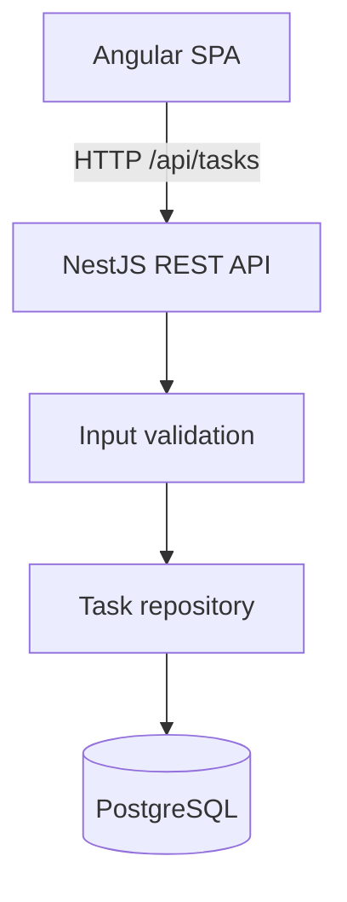

# FlowOps Lite

**A lightweight operations dashboard built with Angular, NestJS, PostgreSQL and TypeScript.**

> **Project status:** early portfolio demo (`v0.1`). This is a self-authored learning and portfolio project, **not** a commercial customer deployment. Screens and data are synthetic. Backend authentication exists; the Angular dashboard is still anonymous. Multi-tenancy and production hardening are not complete.

## What it does

- List tasks loaded from a real PostgreSQL database through the NestJS REST API.
- Filter, search, sort and paginate tasks through `GET /api/tasks` (status, priority, `search` on title/team).
- Create new tasks with both client-side and server-side validation.
- Update task statuses (`To do`, `In progress`, `Done`) and persist changes.
- Show dashboard totals from server pagination metadata for the current query, not from the current page of rows.
- Load initial example data automatically into a fresh local database.

### Stack

| Layer | Technology |
|---|---|
| Frontend | Angular 20, standalone components, signals, reactive API state, CSS |
| Backend | NestJS 11, TypeScript, parameterized SQL with `pg` |
| Database | PostgreSQL 16 via Docker Compose |
| Quality | Node.js test runner via `tsx` (unit + PostgreSQL integration), GitHub Actions |

## Architecture



The frontend development server proxies `/api` requests to the backend. Frontend and backend share the same domain concepts (task, priority, status), but their code is intentionally kept separate for clarity.

## Run locally (Windows / macOS / Linux)

Requirements: Node.js 22 LTS (or >=20.19), npm, Docker Desktop (or Docker Engine). A working internet connection is required for the initial `npm install`.

Run from the **repository root**:

```bash
npm install
docker compose up -d
```

Create a local `.env` from `.env.example`, then open **two terminals**:

**Terminal A — API**
```bash
npm run dev:api
```

**Terminal B — Angular SPA**
```bash
npm run dev:web
```

Open **http://127.0.0.1:4300**. The frontend will use the API at `/api/tasks` through its dev proxy. Check **http://localhost:3000/api/health** to verify the API. Docker's default local DB credentials are explicitly **development-only**.

> On Windows PowerShell, to create `.env`: `Copy-Item .env.example .env`. A `.env` file is optional for the default local DB settings, but useful for later configuration. `docker compose up -d` needs Docker Desktop running.

### Run checks

```bash
npm run test
npm run test:integration
npm run build
```

`npm run test` runs API domain/auth unit tests and Angular service/query tests (Node.js `node:test` via `tsx`). `npm run test:integration` runs Nest tests against isolated databases (`flowops_test`, `flowops_test_migrate`, `flowops_test_auth`, `flowops_test_auth_rl`). Those suites never drop, truncate, or migrate-reset `flowops`. Postgres must be running (`docker compose up -d`). GitHub Actions runs both suites. The production build compiles API and web. There are no browser E2E tests in CI.

### Database migrations

The API applies versioned SQL from `apps/api/migrations/` on startup, before task seed or queries. A `schema_migrations` table records version, name, checksum and `applied_at`. Pending files run in filename order inside a transaction, under a PostgreSQL advisory lock.

| File | Purpose |
|---|---|
| `001_baseline_tasks.sql` | Creates `tasks` on a fresh database. On an existing FlowOps database it **verifies** the current `tasks` columns/constraints and records the baseline without rewriting the table or touching rows. An incompatible `tasks` table fails the startup instead of being marked applied. |
| `002_create_users.sql` | Adds `users` (unique `LOWER(email)`, role `ADMIN`/`MEMBER`). No user rows are inserted. |
| `003_create_refresh_sessions.sql` | Adds `refresh_sessions` (FK to `users`, unique `token_hash`). No session rows are inserted. |

Fresh install: `docker compose up -d` then `npm run dev:api` — migrations create the schema, then empty `tasks` is seeded with the sample rows.

Existing local `flowops` volume: the same startup applies pending migrations only. Task rows are not deleted by schema migrations. Task ownership (`owner_id`) is not applied yet.

There is no `migrate` CLI; starting the API is enough. Re-running startup is idempotent when SQL files are unchanged. Changing an already-applied file is rejected via checksum.

### API endpoints

| HTTP | Endpoint | Auth | Description |
|---|---|---|---|
| GET | `/api/health` | Public | Service health |
| GET | `/api/tasks` | Public | List tasks with optional paging, filters, search and sort |
| POST | `/api/tasks` | Public | Add task (`title`, `team`, `priority`) |
| PATCH | `/api/tasks/:id/status` | Public | Update status (`todo`, `in_progress`, `done`) |
| POST | `/api/auth/login` | Public + CSRF | Email/password login; sets cookies |
| POST | `/api/auth/refresh` | Refresh cookie + CSRF | Rotate refresh session; sets new cookies |
| POST | `/api/auth/logout` | Cookie optional + CSRF | Revoke session family; clear cookies |
| GET | `/api/auth/me` | Access cookie or Bearer | Current user |

### Authentication

The Angular dashboard does **not** send credentials yet. Task routes stay public until M2.2-A.

**Environment**

| Variable | Purpose |
|---|---|
| `JWT_SECRET` | HS256 secret, **minimum 32 characters**. Required for `/api/auth/*`. If missing, the API still serves tasks; auth endpoints return **503**. Never commit a real secret. |
| `AUTH_COOKIE_SECURE` | `true`/`false`. Default `true` when `NODE_ENV=production`. Local HTTP at `http://127.0.0.1:4300` must use `false`. |
| `AUTH_WEB_ORIGIN` | Allowed `Origin` values (comma-separated). Default `http://127.0.0.1:4300`. |
| `BOOTSTRAP_ADMIN_EMAIL` / `BOOTSTRAP_ADMIN_PASSWORD` | Optional first ADMIN. Set **both** or neither. Applied only when `users` is empty. Does not reset an existing password. |

Provision the first admin: put a strong password in `.env` (not in git), start the API once, then remove the bootstrap variables if you want. Logs never include the password or hash.

**Cookies** (`HttpOnly`, `SameSite=Lax`, host-only — no `Domain`):

| Cookie | Path | Lifetime |
|---|---|---|
| `flowops_at` | `/api` | 15 minutes (JWT access) |
| `flowops_rt` | `/api/auth` | 7 days (opaque refresh) |

Tokens are never returned in JSON. Production must be HTTPS so `Secure` cookies are sent. Local development uses the Angular proxy (`127.0.0.1:4300` → API) as same-origin HTTP.

**Refresh rotation:** presented refresh token is hashed (SHA-256) and locked with `SELECT … FOR UPDATE`. A valid unused row is marked `replaced_at` and exactly one successor is inserted in the same transaction. Reuse of a replaced token **revokes the whole family**. Logout revokes the family and is idempotent. Access JWTs remain valid until expiry (no denylist); that is a documented 15-minute window after logout.

**Multi-tab race:** two concurrent refreshes of the same token are serialized. The second request is treated as reuse and revokes the family, which can sign the user out of every tab. Future Angular code must single-flight refresh. The backend does not weaken reuse detection to hide that race.

**CSRF (auth mutations only):** `POST /api/auth/login|refresh|logout` require header `X-Requested-With: FlowOpsWeb`. If `Origin` is present it must match `AUTH_WEB_ORIGIN`. `Sec-Fetch-Site: cross-site` is rejected. Non-browser clients should send the custom header; they may omit `Origin`. **Task write endpoints do not require this header yet.** CORS remains disabled (no credentialed `*`).

**Rate limits** (in-memory, per API process, per IP from `req.ip` — `X-Forwarded-For` is ignored): login **5/minute**, refresh **20/minute**, HTTP **429**. Health checks are not throttled. Multiple instances each have their own counters.

**JWT:** `jose` HS256, issuer `flowops`, audience `flowops-web`, claims `sub`, `role`, `jti`, `iat`, `exp`. Cookie or `Authorization: Bearer`. Passwords are Argon2id (OWASP-style 19 MiB, t=2, p=1). Unknown emails still run a dummy verify. Public registration is not implemented.

`GET /api/tasks` query parameters:

| Param | Default | Notes |
|---|---|---|
| `page` | `1` | Positive integer |
| `limit` | `20` | Positive integer, maximum `100` |
| `status` | — | `todo`, `in_progress`, `done` |
| `priority` | — | `low`, `medium`, `high` |
| `search` | — | Case-insensitive match on title or team (max 120 chars) |
| `sortBy` | `createdAt` | `id`, `title`, `team`, `priority`, `status`, `createdAt`, `updatedAt` |
| `sortOrder` | `desc` | `asc` or `desc` |

Invalid values return **HTTP 400**. Filtering, search, sort and pagination run in PostgreSQL. Sort is deterministic (`sortBy`, then `id`). Response shape:

```json
{
  "items": [],
  "pagination": { "page": 1, "limit": 20, "total": 0, "totalPages": 0 }
}
```

Example requests:

```bash
curl "http://localhost:3000/api/tasks?page=1&limit=20&status=todo&priority=high&search=gateway&sortBy=createdAt&sortOrder=desc"

curl -X POST http://localhost:3000/api/tasks \
  -H "Content-Type: application/json" \
  -d '{"title":"Refine team dashboard","team":"Frontend","priority":"high"}'
```

## Engineering choices and limitations

1. **PostgreSQL rather than a fake frontend-only API.** Persists data across restarts.
2. **Typed DTO validation and parameterized SQL.** Server validates external inputs instead of trusting the UI.
3. **Angular signals + RxJS.** The task list is driven by the paged API. Search uses `debounceTime(300)`, `distinctUntilChanged` and `switchMap`. Dashboard numbers use the server `pagination.total`, not counts from the current page.
4. **Minimal dependencies.** UI uses native HTML controls and custom CSS rather than a large component library.
5. **Explicit scope.** Backend login/refresh/logout exist; the SPA is still anonymous and task routes are still public. RBAC and task ownership are not implemented. There is no dedicated `team` query parameter: team matching is part of `search`. Do not expose this API on the public internet without the Angular auth UI and task authorization.

Future improvements are recorded in [`docs/ROADMAP.md`](docs/ROADMAP.md).

## About the portfolio

This is a demonstration of engineering approach, not evidence of a commercial engagement. The author also has professional experience developing enterprise Angular applications, REST APIs and AWS-based solutions, as described separately in the CV and professional project case studies.

---

**License:** MIT (see [LICENSE](LICENSE)).
