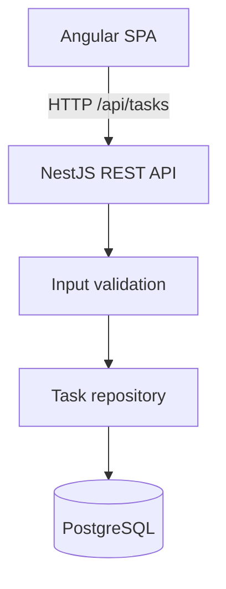

# FlowOps Lite

**A lightweight operations dashboard built with Angular, NestJS, PostgreSQL and TypeScript.**

> **Project status:** early portfolio demo (`v0.1`). This is a self-authored learning and portfolio project, **not** a commercial customer deployment. Screens and data are synthetic. Authentication, multi-tenancy and production deployment are not implemented yet.

## What it does

- List tasks loaded from a real PostgreSQL database through the NestJS REST API.
- Filter, search, sort and paginate tasks through `GET /api/tasks` (status, priority, `search` on title/team).
- Create new tasks with both client-side and server-side validation.
- Update task statuses (`To do`, `In progress`, `Done`) and persist changes.
- Show dashboard totals from server pagination metadata for the current query, not from the current page of rows.
- Load initial example data automatically into a fresh local database.

### Stack

| Layer | Technology |
|---|---|
| Frontend | Angular 20, standalone components, signals, reactive API state, CSS |
| Backend | NestJS 11, TypeScript, parameterized SQL with `pg` |
| Database | PostgreSQL 16 via Docker Compose |
| Quality | Node.js test runner via `tsx` (unit + PostgreSQL integration), GitHub Actions |

## Architecture



The frontend development server proxies `/api` requests to the backend. Frontend and backend share the same domain concepts (task, priority, status), but their code is intentionally kept separate for clarity.

## Run locally (Windows / macOS / Linux)

Requirements: Node.js 22 LTS (or >=20.19), npm, Docker Desktop (or Docker Engine). A working internet connection is required for the initial `npm install`.

Run from the **repository root**:

```bash
npm install
docker compose up -d
```

Create a local `.env` from `.env.example`, then open **two terminals**:

**Terminal A — API**
```bash
npm run dev:api
```

**Terminal B — Angular SPA**
```bash
npm run dev:web
```

Open **http://127.0.0.1:4300**. The frontend will use the API at `/api/tasks` through its dev proxy. Check **http://localhost:3000/api/health** to verify the API. Docker's default local DB credentials are explicitly **development-only**.

> On Windows PowerShell, to create `.env`: `Copy-Item .env.example .env`. A `.env` file is optional for the default local DB settings, but useful for later configuration. `docker compose up -d` needs Docker Desktop running.

### Run checks

```bash
npm run test
npm run test:integration
npm run build
```

`npm run test` runs API domain tests and Angular service/query tests (Node.js `node:test` via `tsx`). `npm run test:integration` boots Nest against an isolated `flowops_test` database (created if missing) and never truncates `flowops`. Postgres must be running (`docker compose up -d`). GitHub Actions runs both suites. The production build compiles API and web. There are no browser E2E tests in CI.

### API endpoints

| HTTP | Endpoint | Description |
|---|---|---|
| GET | `/api/health` | Service health |
| GET | `/api/tasks` | List tasks with optional paging, filters, search and sort |
| POST | `/api/tasks` | Add task (`title`, `team`, `priority`) |
| PATCH | `/api/tasks/:id/status` | Update status (`todo`, `in_progress`, `done`) |

`GET /api/tasks` query parameters:

| Param | Default | Notes |
|---|---|---|
| `page` | `1` | Positive integer |
| `limit` | `20` | Positive integer, maximum `100` |
| `status` | — | `todo`, `in_progress`, `done` |
| `priority` | — | `low`, `medium`, `high` |
| `search` | — | Case-insensitive match on title or team (max 120 chars) |
| `sortBy` | `createdAt` | `id`, `title`, `team`, `priority`, `status`, `createdAt`, `updatedAt` |
| `sortOrder` | `desc` | `asc` or `desc` |

Invalid values return **HTTP 400**. Filtering, search, sort and pagination run in PostgreSQL. Sort is deterministic (`sortBy`, then `id`). Response shape:

```json
{
  "items": [],
  "pagination": { "page": 1, "limit": 20, "total": 0, "totalPages": 0 }
}
```

Example requests:

```bash
curl "http://localhost:3000/api/tasks?page=1&limit=20&status=todo&priority=high&search=gateway&sortBy=createdAt&sortOrder=desc"

curl -X POST http://localhost:3000/api/tasks \
  -H "Content-Type: application/json" \
  -d '{"title":"Refine team dashboard","team":"Frontend","priority":"high"}'
```

## Engineering choices and limitations

1. **PostgreSQL rather than a fake frontend-only API.** Persists data across restarts.
2. **Typed DTO validation and parameterized SQL.** Server validates external inputs instead of trusting the UI.
3. **Angular signals + RxJS.** The task list is driven by the paged API. Search uses `debounceTime(300)`, `distinctUntilChanged` and `switchMap`. Dashboard numbers use the server `pagination.total`, not counts from the current page.
4. **Minimal dependencies.** UI uses native HTML controls and custom CSS rather than a large component library.
5. **Explicit scope.** No authentication, RBAC, migration versioning, concurrency conflict detection, audit logs, or deployment hardening. There is no dedicated `team` query parameter: team matching is part of `search`. Do not deploy this repository publicly with write endpoints until those are implemented.

Future improvements are recorded in [`docs/ROADMAP.md`](docs/ROADMAP.md).

## About the portfolio

This is a demonstration of engineering approach, not evidence of a commercial engagement. The author also has professional experience developing enterprise Angular applications, REST APIs and AWS-based solutions, as described separately in the CV and professional project case studies.

---

**License:** MIT (see [LICENSE](LICENSE)).
